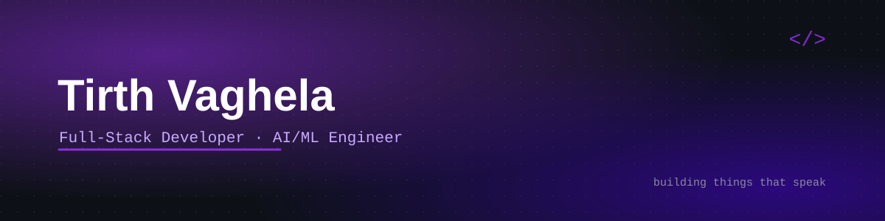

<div align="center">




<br/>

[](https://tirthvaghela.in/)
[](https://www.linkedin.com/in/tirthvaghela/)
[](https://github.com/Tirthvaghela)
[](mailto:vaghelatirth719@gmail.com)


</div>

<br/>

<table>
<tr>
<td width="60%" valign="top">

### 👋 About Me

```yaml
name: Tirth Vaghela
role: Full-Stack Developer & AI/ML Engineer
education: Integrated M.Sc IT — GLS University, Ahmedabad

currently_building:
  - VoiceForm AI
  - AI-powered document & form processing systems

specialization:
  - Computer Vision
  - LLM-powered applications
  - OCR & document intelligence
  - Full-stack system architecture
  - Real-time applications

tech_focus:
  - Python
  - TypeScript / JavaScript
  - React / Next.js
  - Flask / FastAPI / Django
  - OpenCV / YOLO
  - LLMs / OCR

ask_me_about:
  - AI system design
  - Computer Vision pipelines
  - Full-stack development
  - Shipping AI products

fun_fact:
  edits videos and plays guitar between deploys
```

</td>

<td width="40%" valign="top">

### 🖥️ terminal

```bash
$ whoami
tirth-vaghela

$ cat status.txt
[ONLINE] shipping code

$ ./run --project=VoiceForm-AI

> document-vision [OK]
> OCR........... [OK]
> LLM-dialogue.. [OK]
> voice-loop.... [OK]
> form-writing.. [OK]

$ echo $STATUS
"building systems, not demos"
```

</td>
</tr>
</table>

---

## 🚀 What I'm Building

### 🎙️ VoiceForm AI

**Multilingual AI-powered form filling**

Turn paper/PDF forms into a conversational experience using **OCR + Computer Vision + LLMs + Speech-to-Text**.

```text
Paper / PDF
     │
     ▼
┌───────────────┐
│ Document      │
│ Understanding │
└───────┬───────┘
        ▼
┌───────────────┐
│ OCR + Vision  │
└───────┬───────┘
        ▼
┌───────────────┐
│ LLM Dialogue  │
└───────┬───────┘
        ▼
┌───────────────┐
│ Voice Input   │
│ English/Hindi │
│ Gujarati      │
└───────┬───────┘
        ▼
┌───────────────┐
│ Form Filling  │
└───────────────┘
```

**Core technologies**

`Python` · `Computer Vision` · `OCR` · `LLMs` · `Speech-to-Text` · `Document Processing`

---

## 🛠️ Tech Stack

<div align="center">


</div>

<br/>

<table align="center">
<tr>

<td valign="top" width="25%">

<b>🧠 Languages</b>

<ul>
<li>Python</li>
<li>JavaScript</li>
<li>TypeScript</li>
<li>SQL</li>
<li>Dart</li>
<li>PHP</li>
</ul>

</td>

<td valign="top" width="25%">

<b>🎨 Frontend</b>

<ul>
<li>React</li>
<li>Next.js</li>
<li>Tailwind CSS</li>
<li>Flutter</li>
<li>HTML / CSS</li>
</ul>

</td>

<td valign="top" width="25%">

<b>⚙️ Backend</b>

<ul>
<li>FastAPI</li>
<li>Flask</li>
<li>Django</li>
<li>Node.js</li>
<li>REST APIs</li>
<li>JWT Authentication</li>
</ul>

</td>

<td valign="top" width="25%">

<b>🤖 AI / Data</b>

<ul>
<li>OpenCV</li>
<li>YOLOv4 / YOLOv8</li>
<li>OCR</li>
<li>DeepFace</li>
<li>ArcFace</li>
<li>LLM APIs</li>
</ul>

</td>

</tr>
</table>

---

## 🤖 AI & Computer Vision Projects

<table>
<tr>

<td width="33%" valign="top">

### 🚦 Urban Signal

**AI Traffic Management Platform**

Real-time traffic signal optimization using intersection congestion data.

Also detects emergency vehicles and provides priority routing overrides.

`Next.js` · `Flask` · `YOLOv4` · `OpenCV`

</td>

<td width="33%" valign="top">

### 🏍️ RIGS

**Road Infraction Governance System**

Automated helmet-compliance monitoring for two-wheelers.

Detects violations → crops license plates → performs OCR → generates e-challans.

`React` · `YOLOv8` · `Node.js` · `OCR`

</td>

<td width="33%" valign="top">

### 📸 Wedding Face Finder

**Biometric Image Search Engine**

Indexes large, unorganized photo collections using face embeddings.

Supports fast face search and clustering.

`Flask` · `DeepFace` · `ArcFace`

</td>

</tr>
</table>

---

## 🌐 Full-Stack Projects

<table>
<tr>

<td width="50%" valign="top">

### 🗳️ Electrox Ecosystem

**Web & Mobile Voting Platform**

Multi-platform voting system covering the complete election lifecycle.

Features:

* Role-based access control
* Election management
* Candidate management
* Live analytics
* Web + mobile clients

`Flutter` · `React` · `Node.js` · `Flask` · `MongoDB`

</td>

<td width="50%" valign="top">

### 🌪️ Vois

**Social Media Engine**

Real-time social platform with:

* Follow system
* Personalized feed
* JWT authentication
* User accounts
* REST APIs

`React` · `FastAPI` · `MongoDB`

</td>

</tr>

<tr>

<td width="50%" valign="top">

### 📅 EventEase

**College Event Management System**

End-to-end event registration platform with:

* Event capacity limits
* Registration management
* REST APIs
* Automated confirmation emails

`Django` · `REST API` · `SQLite`

</td>

<td width="50%" valign="top">

### 🛒 FreshVault

**Local Grocery E-Commerce Platform**

Grocery marketplace with:

* Customer accounts
* Shopping cart
* Wishlist
* Inventory management
* Admin dashboard

`PHP` · `MySQL` · `Tailwind CSS`

</td>

</tr>
</table>

---

## 🧠 Engineering Focus

```text
┌──────────────────────────────────────────────────────┐
│                  WHAT I LIKE BUILDING                │
├──────────────────────────────────────────────────────┤
│                                                      │
│  👁️ Computer Vision                                 │
│     YOLO · OpenCV · OCR · Face Embeddings            │
│                                                      │
│  🧠 LLM Applications                                 │
│     AI Agents · Structured Output · RAG · NLP        │
│                                                      │
│  🎙️ Multimodal Systems                              │
│     Voice · Vision · Documents · LLMs               │
│                                                      │
│  ⚡ Full-Stack Systems                               │
│     React · Next.js · FastAPI · Flask · Django       │
│                                                      │
│  🚀 Product Engineering                              │
│     From prototype → architecture → deployment       │
│                                                      │
└──────────────────────────────────────────────────────┘
```

---

## 📊 GitHub Metrics

<div align="center">


<br/><br/>


</div>

### 📈 Contribution Activity

<div align="center">

<a href="https://github.com/Ashutosh00710/github-readme-activity-graph">


</a>

</div>

> **Note:** The activity graph now uses the project's current canonical Vercel deployment.

---

## 💼 Experience

### ⚡ Full-Stack Web Development Intern

**Prodigy InfoTech** · Remote · Feb 2026

* Built modular and responsive frontend interfaces using semantic HTML/CSS.
* Developed backend routes and integrated REST APIs.
* Implemented token-based authentication middleware.
* Improved API payload handling and application responsiveness.
* Worked across frontend and backend components of production-oriented web applications.

---

## 🎯 Currently Learning

```text
AI Engineering
├── LLM application architecture
├── Multimodal AI
├── RAG pipelines
├── AI agents
└── Evaluation & reliability

Computer Vision
├── Object detection
├── Document understanding
├── OCR pipelines
├── Vision-language models
└── Real-world deployment

Software Engineering
├── System design
├── Scalable APIs
├── Production architecture
├── Testing
└── CI/CD
```

---

## 📫 Connect With Me

<div align="center">

[](https://tirthvaghela.in/)

[](https://www.linkedin.com/in/tirthvaghela/)

[](https://github.com/Tirthvaghela)

[](mailto:vaghelatirth719@gmail.com)

</div>

---

<div align="center">

### 🎨 Outside of Code

🎬 Video Editing  · 
🎨 Drawing  · 
🎸 Guitar  · 
🧠 Exploring New Tech  · 
🎵 Music While Coding

<br/><br/>


</div>
