<picture>
  <source media="(prefers-color-scheme: dark)" srcset="banner-dark.svg">
  
</picture>

<a href="https://tirthvaghela.in/"><picture><source media="(prefers-color-scheme: dark)" srcset="assets/link-portfolio-dark.svg"></picture></a>
<a href="https://www.linkedin.com/in/tirthvaghela/"><picture><source media="(prefers-color-scheme: dark)" srcset="assets/link-linkedin-dark.svg"></picture></a>
<a href="https://github.com/Tirthvaghela"><picture><source media="(prefers-color-scheme: dark)" srcset="assets/link-github-dark.svg"></picture></a>
<a href="mailto:vaghelatirth719@gmail.com"><picture><source media="(prefers-color-scheme: dark)" srcset="assets/link-email-dark.svg"></picture></a>

  

<picture><source media="(prefers-color-scheme: dark)" srcset="assets/about-dark.svg">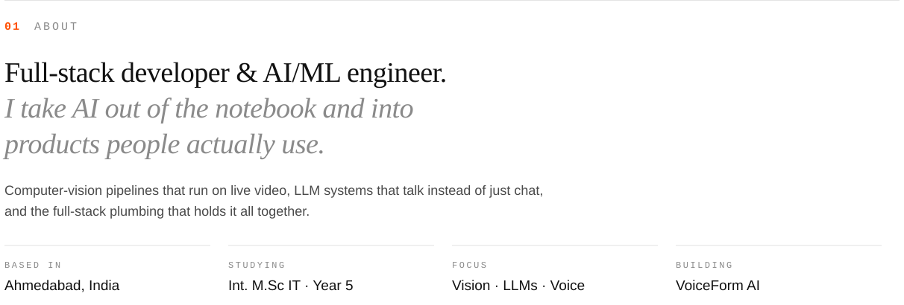</picture>

  

<a href="https://github.com/Tirthvaghela/VoiceForm.Ai"><picture><source media="(prefers-color-scheme: dark)" srcset="assets/now-dark.svg">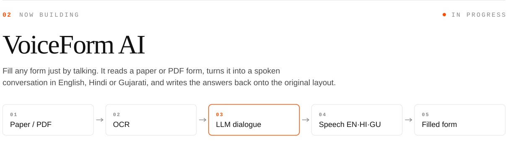</picture></a>

  

<picture><source media="(prefers-color-scheme: dark)" srcset="assets/work-dark.svg"></picture>

<a href="https://github.com/Tirthvaghela/Urban_Signal"><picture><source media="(prefers-color-scheme: dark)" srcset="assets/project-01-dark.svg">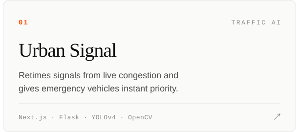</picture></a>
<a href="https://github.com/Tirthvaghela/RIGS"><picture><source media="(prefers-color-scheme: dark)" srcset="assets/project-02-dark.svg">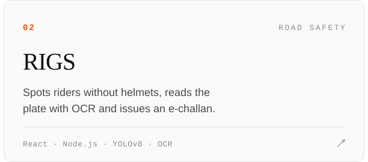</picture></a>

<a href="https://github.com/Tirthvaghela/Wedding-Face-Finder"><picture><source media="(prefers-color-scheme: dark)" srcset="assets/project-03-dark.svg">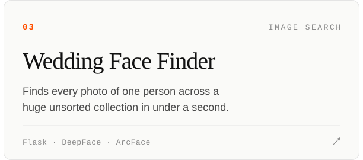</picture></a>
<a href="https://github.com/Tirthvaghela/Electrox"><picture><source media="(prefers-color-scheme: dark)" srcset="assets/project-04-dark.svg">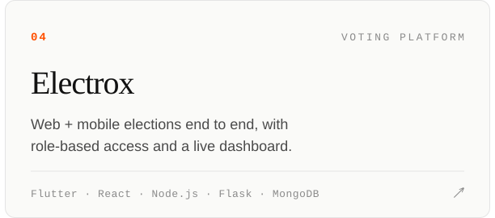</picture></a>

<a href="https://github.com/Tirthvaghela/Vois"><picture><source media="(prefers-color-scheme: dark)" srcset="assets/project-05-dark.svg">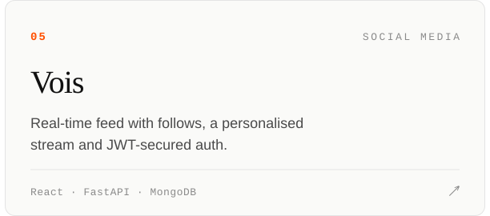</picture></a>
<a href="https://github.com/Tirthvaghela/EventEase"><picture><source media="(prefers-color-scheme: dark)" srcset="assets/project-06-dark.svg">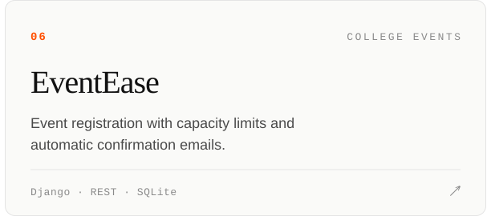</picture></a>

<a href="https://github.com/Tirthvaghela/FreshValut"><picture><source media="(prefers-color-scheme: dark)" srcset="assets/project-07-dark.svg">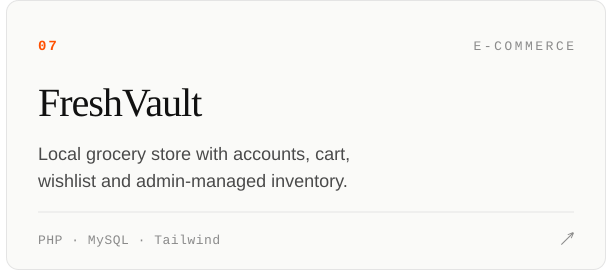</picture></a>
<a href="https://github.com/Tirthvaghela?tab=repositories"><picture><source media="(prefers-color-scheme: dark)" srcset="assets/project-more-dark.svg">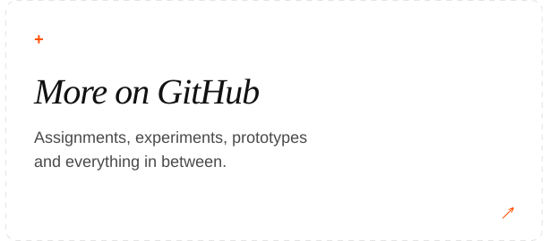</picture></a>

  

<picture><source media="(prefers-color-scheme: dark)" srcset="assets/toolkit-dark.svg">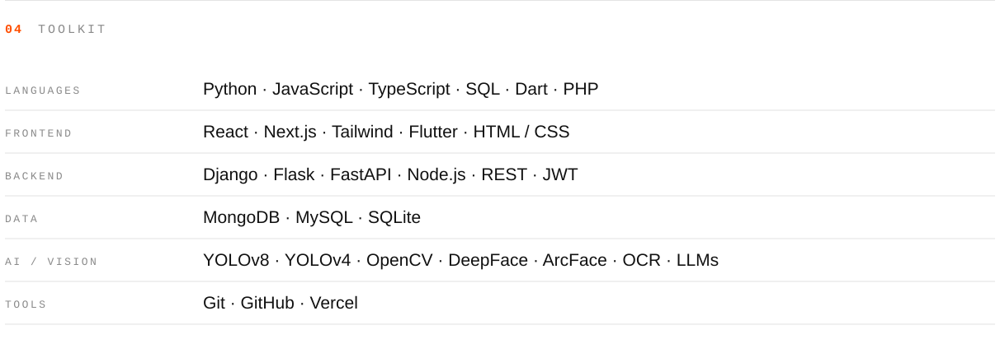</picture>

  

<picture><source media="(prefers-color-scheme: dark)" srcset="assets/experience-dark.svg">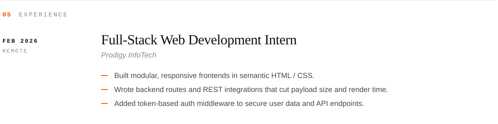</picture>

  

<picture><source media="(prefers-color-scheme: dark)" srcset="assets/activity-dark.svg"></picture>

<picture>
  <source media="(prefers-color-scheme: dark)" srcset="https://github-readme-activity-graph.vercel.app/graph?username=Tirthvaghela&hide_border=true&hide_title=true&area=false&line=FF4F00&bg_color=0d1117&color=7d8590&point=f0f0f0">
  
</picture>

  

<picture><source media="(prefers-color-scheme: dark)" srcset="assets/footer-dark.svg"></picture>
