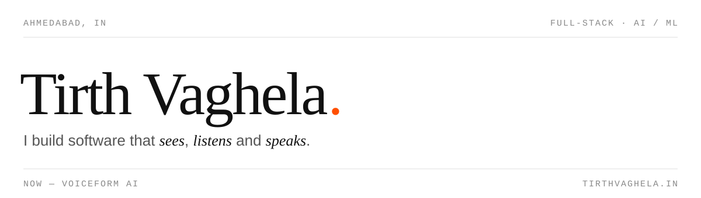

<picture>
  <source media="(prefers-color-scheme: dark)" srcset="https://raw.githubusercontent.com/Tirthvaghela/Tirthvaghela/main/banner-dark.svg">
  
</picture>

<p>
  <a href="https://tirthvaghela.in/">Portfolio ↗</a> &nbsp;&nbsp;
  <a href="https://www.linkedin.com/in/tirthvaghela/">LinkedIn ↗</a> &nbsp;&nbsp;
  <a href="https://github.com/Tirthvaghela">GitHub ↗</a> &nbsp;&nbsp;
  <a href="mailto:vaghelatirth719@gmail.com">Email ↗</a>
</p>

<br>

### 01 &nbsp;—&nbsp; About

Full-stack developer and AI/ML engineer, in the final year of an Integrated M.Sc IT
at GLS University, Ahmedabad.

I take AI out of the notebook and into real products: computer-vision pipelines
that run on live video, LLM systems that *talk* instead of just chat, and the
full-stack plumbing that holds it together.

<sub>Happy to talk about system design, CV pipelines, and shipping side projects fast.</sub>

<br>

### 02 &nbsp;—&nbsp; Now

**VoiceForm AI** &nbsp;<sub>in progress</sub>

Fill any form just by talking. VoiceForm AI reads a paper or PDF form, turns it
into a spoken conversation in English, Hindi or Gujarati, and writes the answers
back onto the original layout.

```
paper / pdf  →  ocr  →  llm dialogue  ⇄  speech (en · hi · gu)  →  filled form
```

<br>

### 03 &nbsp;—&nbsp; Selected Work

| | Project | What it does | Built with |
|:--|:--|:--|:--|
| `01` | **Urban Signal**<br><sub>Traffic AI</sub> | Retimes signals from live intersection congestion; detects emergency vehicles and gives them priority. | <sub>Next.js · Flask · YOLOv4 · OpenCV</sub> |
| `02` | **RIGS**<br><sub>Road safety</sub> | Spots riders without helmets, reads the number plate with OCR, and issues an e-challan automatically. | <sub>React · Node.js · YOLOv8 · OCR</sub> |
| `03` | **Wedding Face Finder**<br><sub>Image search</sub> | Finds every photo of one person in a huge unsorted collection in under a second. | <sub>Flask · DeepFace · ArcFace</sub> |
| `04` | **Electrox**<br><sub>Voting platform</sub> | Web + mobile elections end to end, with role-based access and a live admin dashboard. | <sub>Flutter · React · Node.js · Flask · MongoDB</sub> |
| `05` | **Vois**<br><sub>Social media</sub> | Real-time feed with follows, a personalised stream, and JWT auth. | <sub>React · FastAPI · MongoDB</sub> |
| `06` | **EventEase**<br><sub>College events</sub> | Event registration with capacity limits and automatic confirmation emails. | <sub>Django · REST · SQLite</sub> |
| `07` | **FreshVault**<br><sub>E-commerce</sub> | Local grocery store with accounts, cart, wishlist, and admin inventory. | <sub>PHP · MySQL · Tailwind</sub> |

<br>

### 04 &nbsp;—&nbsp; Toolkit

```
languages     python   javascript   typescript   sql   dart   php
frontend      react   next.js   tailwind   flutter   html/css
backend       django   flask   fastapi   node.js   rest   jwt
data          mongodb   mysql   sqlite
ai / vision   yolov8   yolov4   opencv   deepface   arcface   ocr   llms
tools         git   github   vercel
```

<br>

### 05 &nbsp;—&nbsp; Experience

**Full-Stack Web Development Intern** · Prodigy InfoTech &nbsp;<sub>Feb 2026 · Remote</sub>

Built responsive, modular frontends in semantic HTML/CSS; wrote backend routes
and REST integrations that cut payload size and render time; added token-based
auth middleware to secure user data and APIs.

<br>

### 06 &nbsp;—&nbsp; Activity

<picture>
  <source media="(prefers-color-scheme: dark)" srcset="https://github-readme-activity-graph.vercel.app/graph?username=Tirthvaghela&hide_border=true&bg_color=0d1117&color=7d8590&line=FF4F00&point=f0f0f0&title_color=f0f0f0&area=false&custom_title=Contributions">
  
</picture>

<br>

---

<sub>Off the keyboard: video editing, drawing, guitar, and music while coding.</sub>
